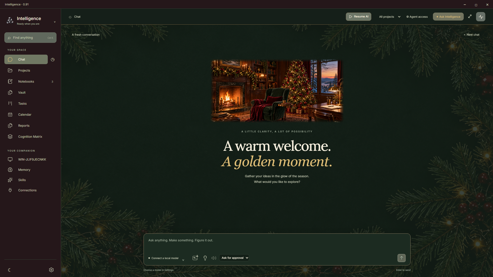
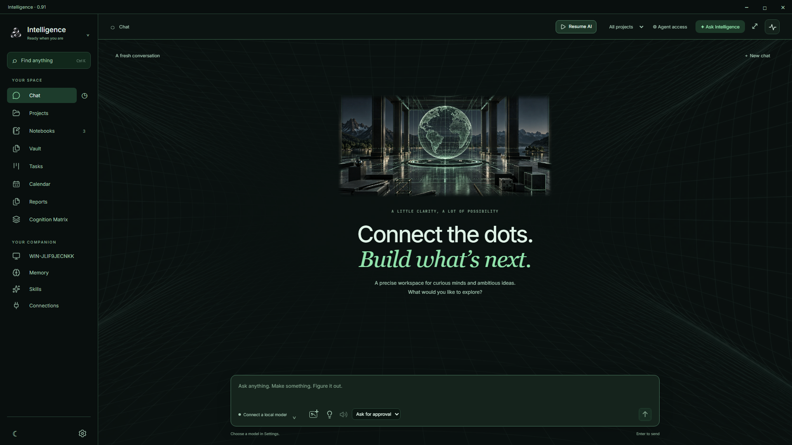
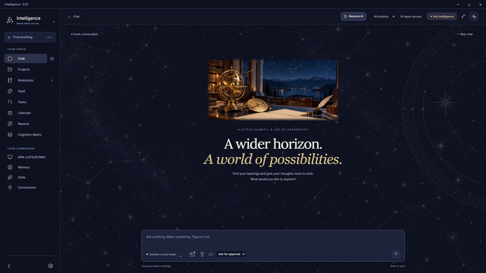

# Intelligence 1.06

Intelligence is a personal AI harness for people who do not want to manage a complicated toolchain. It brings conversations, notes, tasks and an assistant into one understandable Linux desktop workspace. The goal is to make working with AI easy to use and easy to understand, with clear controls over what the assistant can access and do.

[](https://ko-fi.com/B0B5KQRRD)

**Development preview · Linux is the target platform.** This repository contains the source, build scripts, original artwork and license notices. Ready-to-use installers are not published here yet; target Linux and live-model checks remain on the [release checklist](docs/RELEASE_CHECKLIST.md).

## A workspace that feels like yours

Ten themes include Ink, Day, Night, Summer, Autumn, Winter Wonderland, Festive, Tech, Astral and Marble & gold. Each has original artwork and readable controls. Still backgrounds are independent: combine any theme with built-in artwork or your own image, adjust strength, and choose 0–24 px blur. The Festive, Tech, Astral and Marble & gold themes include detailed landscape backgrounds. Still artwork stays separate from automatic AI work.

| Festive                                   | Tech                                             |
| ----------------------------------------- | ------------------------------------------------ |
|  |               |
| Astral                                    | Marble & gold                                    |
|    |  |

## What you can do

- Talk through an idea and keep the conversation for later.
- Organize your writing in notebooks, chapters and notes, or work with ordinary Markdown files.
- Keep personal work on task boards and assign selected work to the assistant. The separate Cognition Matrix is the assistant's own work queue.
- Choose local models or cloud services, and keep multiple providers connected.
- Give each assistant access to selected resources, approve current-request or permanent scopes, review actions and steer it while it works.
- Follow resumable setup, optional feature lessons and an offline written guide.
- Add speech, dictation and offline archives when you need them; optional downloads stay separate from the application.

Your workspace is stored locally. Messages sent to a cloud provider, remote tool server or search service follow the choices you configure; local storage does not mean every configured service runs offline.

## Assistant controls

- Steer a running conversation with corrections delivered between model/tool steps. General responses have a persisted 1–256 round limit (default 12); Matrix and reports keep their own budgets.
- Keep local and API providers connected together, choose provider/model per conversation or agent, and disconnect individual providers with saved-key removal. LM Studio, Ollama, llama.cpp, OpenAI, OpenRouter, Mistral, Qwen and compatible APIs are supported.
- Agent task controls and reports appear only on cards with effective agent access; board/list inheritance and card exceptions apply.
- Persistent streaming chat, returned Thinking, grouped tool activity and conversation branches. Main Chat and the assistant share compact model/Add sources/Thinking/TTS/microphone/approval controls, with searchable model selection.
- Agent profiles with their own model, personality, skills and tool scopes. Mandatory application guidance and native permissions remain enforced.
- Notebooks, chapters, Markdown notes and a real-file Markdown Vault, with recoverable Trash and revision history.
- Kanban boards with draggable list ordering and a three-list Cognition Matrix. Core stays fixed; Secondary and Tertiary can be renamed.
- Projects with authorized file browsing, edits and reviewable differences; Calendar, scheduled work, reports and activity history.
- Searchable memory with saved facts/summaries, source-message excerpts and live access details; private conversation recall, optional local speech/dictation and offline ZIM archive tools.
- Agent-requested MCP setup with a bundled setup skill, explicit native configuration review, stdio/Streamable HTTP support and preserved profile scopes.
- Saved chapter body text can be read and copied into an actual note; completed agent writes appear during the response and survive Stop.
- Local MCP connections, provider credentials protected by the desktop, and complete portable backups.
- English by default, with Romanian UI and user content kept in its original language.

No chat model or optional speech/archive engine is bundled. Downloads happen in user data after the relevant setup action. Intelligence does not silently switch to a cloud provider.

## Workspace and ongoing work

The 1.06 profile implements the selected [Balanced workspace concept A](docs/design/agent-profile-alternatives-2026-10-15/README.md): image/name and default model on the left, a large system-prompt editor in the center, and visible ratings/tools on the right. User context is removed from this screen. More tool categories, Skills and MCP servers open focused dialogs; search and pages keep long catalogs visible without scrolling. The main profile fits at 1080p and tested shorter windows. Resource access retains its separate grant editor. The 1.04 native file and prompt changes remain: Computer access → Any file on the computer permits native file work outside projects within OS permissions, with separate action approvals and per-agent restrictions. The agent receives its effective scope/home/working directory and can inspect live file access. Home paths such as `~/Downloads` resolve correctly. Relevant skill bodies load on demand; skill names and selected-resource metadata stay with their user turn so they do not rewrite the system prefix. See [verification and inference notes](docs/PROFILE_FILES_AND_PROMPT.md).

The 1.03 follow-up gives Skills, Projects and Connections equal-size cards within each collection. Skills availability and instruction actions align at the bottom; list mode keeps learned-skill metadata in a dedicated area so it cannot squeeze the instruction button. Rows adapt to the available pane width. See the [collection repair review](docs/design/collection-layout-2026-10-15/README.md).

The 1.02 interface update spaces appearance/sharing controls, consolidates Agent access, and keeps profile ratings beside identity. Model choices scroll within their picker without covering its status or Settings action. Chat artwork uses the same bounds across all ten themes, with clearer secondary text colors. See the [UI repair review](docs/design/ui-repairs-2026-10-15/README.md) for visual references and verification coverage.

The last project selection and desktop window bounds are restored. First launch uses a smaller 1280×800 window, fitted to the display. Model pickers support search; chat uses a symbolic model button. Matrix lists and Tasks assignments select an agent profile, carrying its model, style, skills and restrictions. Switching the active chat agent does not reassign existing work.

Add sources attaches files/images or bounded folder snapshots, or identifies existing resources in notebook/task trees. Choose conversation-only copies or project retention. Originals are preserved; retained project copies survive chat deletion. Conversation-only files follow recoverable Trash, then are collected on permanent deletion when no branch still uses them. Automatic memory/skill learning stays off for these chats unless explicitly enabled. Existing exported backups remain independent copies.

Backups include conversation files and inbox queue state. Restoring a backup resets computer-wide and additional-folder grants for review, restores destructive-action protection, and marks interrupted file work for attention.

Agent access combines app gates, per-agent grants and computer controls. File tools can use authorized projects, additional read/edit folders or system-wide account access; native app storage, project permissions and profile restrictions remain enforced. Destructive computer-file actions and unclassified shell commands can require separate review. Approved shell commands are not isolated by file-tool scopes. Managed command jobs expose incremental output, input, cancellation and bounded lifetimes; they end with the response/run.

For continuous inbox work, configure Matrix → Schedule & triggers → File monitoring → New completed files continuously. Authorize the watched folder, choose whether to include existing files, and integrate the list. A lightweight native watcher and persistent queue wait for stable files, skip partial-download names, retain arrivals while busy and catch up after startup/resume. The assigned agent runs only for queued work. Failures and interrupted runs require review; native file outputs are tracked to avoid repeat processing. Monitoring requires the app to remain open or in the tray; Pause AI suspends it. A separate system service and persistent shell state are not included.

## Build on Linux

Install Docker Engine and Compose, then run from this source directory:

```bash
docker compose run --build --rm appimage
chmod +x release/Intelligence-1.0.6-x86_64.AppImage
./release/Intelligence-1.0.6-x86_64.AppImage
```

Release/AppImage packaging runs only inside Linux Docker. Docker is needed to build, not to run. See [the Linux build and acceptance guide](docs/LINUX_HANDOFF.md) for runtime dependencies, sandbox/desktop checks and the source-distribution checklist.

## First run

Getting started offers six optional stages: welcome, your profile and companion, model connection, agent access, memory/automatic work, and review. Save & exit preserves your place; Continue setup resumes it. Local-server addresses, cloud API keys and model discovery are explained inline. An explicit reply test sends only a short greeting. You can browse without connecting a model.

Settings → Help & setup contains the searchable offline English/Romanian written guide, optional feature lessons and an explicit setup entry. Opening ordinary Settings never starts or resumes setup. Returning from a setup-origin Settings detour resumes that setup session; completed setup stays completed when reviewed.

Fresh users start with selected resources only and optional sharing, automatic memory processing and model preparation off. Existing preferences stay intact. Both chats offer optional resource selection under Add sources and review exact access requests: Allow for this request expires with the current response; Always allow for this agent saves a grant for that profile until revoked. Agent access shows saved grants and active temporary access. Global gates, child exceptions, task assignment and native command approvals remain enforced.

Settings → Look & feel owns themes, static artwork, imported images, strength and blur. The compact Pause AI control in the workspace header pauses automatic tasks and memory processing; foreground chat remains available.

Data normally lives in `~/.config/Intelligence/`, follows `XDG_CONFIG_HOME`, and can be overridden by `INTELLIGENCE_DATA_DIR`. Close the app before copying its database.

## Development and release

`main` holds reviewed releases and remains the default branch. New work is developed on `dev` and pushed there first when authorized. Merging to `main` and publishing a release are separate, explicit actions.

Continuing with another coding harness or agent? Start with the [development guide](docs/AGENT_HANDOFF.md). It covers the current checkpoint, required reading, native boundaries, verification, versioning, local commits and the separate authorization required for remote actions.

The [1.0 plan](docs/ONBOARDING_1_0_PLAN.md), [implementation notes](docs/ONBOARDING_1_0_IMPLEMENTATION.md) and retained ImageGen concepts document that development milestone. `main` holds the reviewed 1.06 release; development continues on `dev` as the staging branch. The [workspace and automation plan](docs/WORKSPACE_1_01_PLAN.md) records the prior 1.01 update.

Use `npm ci`, `npm run dev`, `npm run build` and `npm test`. Run `node scripts/verify-source.mjs` before sharing source. Desktop fixtures use isolated data under `.test-data/`. See [verification](docs/VERIFICATION.md), [architecture and development](docs/DEVELOPMENT.md), [appearance](docs/APPEARANCE.md) and [release acceptance](docs/RELEASE_CHECKLIST.md).

The public release label is 1.06 (package 1.0.6). Normal updates continue to add 0.01: 1.07, 1.08 and so on. `node scripts/bump-version.mjs` advances the label and its semantic package version together. Run only tests relevant to the change; broaden testing when an issue needs debugging.

After verified changes, refresh the relevant docs and local `Intelligence-source.tar.gz`, then create the local commit with `scripts/commit-version.mjs`. Documentation-only follow-ups retain the app version. The archive is rebuilt from audited tracked source by `scripts/archive-source.mjs` (host `tar` plus Node zlib); `*.tar.gz` intentionally keeps it out of Git. It does not contain Git history, installed dependencies or user data, and is not uploaded by a Git push. Stage intended new files before archiving; inspect the entire tree before the commit helper, which runs `git add .`.

## License

Intelligence's original code is GPL-3.0-only. Read [LICENSE](LICENSE), [COPYRIGHT](COPYRIGHT) and the offline Settings → Licenses reader. Third-party software, fonts, icons, modules, models and archive content retain their own licenses. Public binary distribution requires the exact Linux notices and complete matching corresponding source described in the release checklist.

Voluntary support through [Ko-fi](https://ko-fi.com/B0B5KQRRD) helps development. Donations do not change your GPL rights or require payment to use the source.

## Contributing and reporting problems

See [CONTRIBUTING.md](CONTRIBUTING.md) for development and safe bug reports. Report security concerns privately as described in [SECURITY.md](SECURITY.md). Please remove personal conversations, API keys and private files from anything you share.
