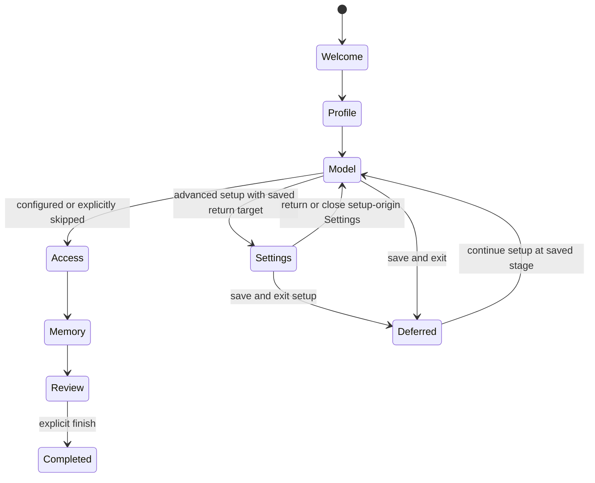

# Intelligence 1.0 — onboarding, help and agent setup proposal

Status: proposed for joint review, 2026-10-14. This change contains planning and design concepts; it does not implement the new flows or change the application's 0.94 / package 0.9.4 version. Work belongs on `dev`. `main` remains the GitHub default and holds reviewed releases.

## Intended experience

A person unfamiliar with AI should be able to connect a model, understand what leaves their computer, choose what their companion may do, and reach a useful first conversation. They should always be able to leave setup and return to the same place. Advanced features should be explained when useful, with a written guide available offline.

Use three complementary layers:

1. **Getting started:** six short setup stages with real configuration controls and saved progress.
2. **Feature lessons:** optional, separately resumable walkthroughs for individual areas of the app.
3. **Written guide:** searchable, offline documentation under the existing Settings → Help & setup disclosure.

Recommendation: modal setup first, optional screen walkthroughs afterward. A long mandatory tour of every screen would interrupt the first useful action and create unnecessary navigation dependencies. The completion screen should offer a next step, not start a tour automatically.

## Findings in the current application

| Area | Evidence | Implication for 1.0 |
| --- | --- | --- |
| Getting started | `src/WorkspacePanels.tsx`, `Onboarding`: five steps, component-local numeric step, several blur-triggered saves. | Progress disappears when the component unmounts. Continue must await saves and expose errors. |
| Settings detour | `src/App.tsx`, onboarding `onSettings`: closes guide, opens model Settings and writes `onboardingComplete: true`. Close also marks complete. | Leaving for setup is currently indistinguishable from finishing. Replace this lifecycle, rather than only adding a Back button. |
| Profile description | `src/SettingsDialog.tsx`: existing 2,000-character `profileDescription` and `shareProfile`. `electron/user-profile.mjs` reads description/photo on demand. | Reuse the existing profile store and privacy checks. Add description to onboarding. Do not create a second biography field. |
| Provider setup | `src/ModelSettings.tsx`, `src/providers.ts`, `electron/inference-providers.mjs`: protected keys, endpoint validation, discovery, grouped providers and no fallback. | Share connection logic and validation between setup and Settings. Add novice instructions and distinct readiness states. |
| Local authentication | Native Ollama/LM Studio providers currently do not accept a stored API key. | Authenticated local servers need an explicit supported token path or an explained compatible-provider path; do not pretend authentication already works. |
| Help | `src/SettingsDialog.tsx`: Help & setup currently contains Getting started only. | Add the written guide and feature lessons here, preserving the existing shallow Settings structure. |
| Approvals | `src/Chat.tsx` presents Approve action / Decline. The same Chat component serves main Chat and the global assistant. `electron/agent.mjs` owns pending native approvals. | Extend one shared approval card and one native request record for both surfaces. Permission grants need more than the current boolean action approval. |
| Authority | `electron/profiles.mjs`, Store/Workspace services and native approvals enforce current resource/profile scopes. | A model may propose a change; only the user's native approval may authorize it. Existing global/profile/resource boundaries must remain meaningful. |

Existing settings remain authoritative. Setup reopening, updating to 1.0 and changing language must not reset personal content, models, permissions, memories or automation preferences.

## Six-stage first-use setup

Use one dialog shell with a stable title, stage indicator, body and footer. Fields are optional unless required for the specific action being taken. Every stage offers Save & exit; optional stages offer Skip for now. Going back preserves edits and saved choices.

| Stage | Onscreen explanation and controls | Result |
| --- | --- | --- |
| 1. Welcome | Language: English / Romanian. Explain model, agent and workspace in one sentence each. Explain local storage separately from provider/tool transmission. Offer Start setup, Explore first and Restore a backup. | The user understands what Intelligence is. Explore first defers setup; restore enters the existing native backup workflow. |
| 2. You and your companion | Name; **Describe yourself. What would you like Intelligence to know about you?**; independent name/profile-sharing choices; agent name and optional assistance style. Avatar/photo are optional expandable controls or later setup. | Existing profile/preferences are saved through shared validated forms. No model call or extra personal-data sharing just from typing. |
| 3. Connect your AI | Choose On this computer / Online service / Set up later. Provider-specific instructions, protected key entry where supported, address, connection check, model selection and optional small response test. Advanced settings are collapsed. | A provider/model is usable, or setup is explicitly deferred with clear guidance on the final screen. |
| 4. Choose what your agent can do | Explain Read versus Read & edit, resource selection/inheritance, task assignment and host-command review. Start with specific selected resources or no access. Offer access requests when needed. | The user sees the actual effective scope and chooses access; connecting a model never grants it. |
| 5. Memory and automatic work | Separate saved memory, automatic summaries/facts, semantic-search downloads and background tasks. State where applicable downloads run, their size when known, and which model/provider handles automatic processing. | New users explicitly choose optional downloads/automatic features. Background task execution, Matrix integration and schedules are separate choices. |
| 6. Review and begin | Summarize provider/model readiness, profile sharing, agent access, memory/automation and pending optional setup. Edit links reopen the relevant stage. Offer Start chatting or Open workspace, plus optional Learn the workspace. | Only the explicit finish action completes setup. Finish without a model means ready to browse, not ready to chat. |

Keep the introduction useful without requiring a name, biography, photo or custom companion. Example style hint: “Explain clearly and ask when unsure.” Style preferences must remain separate from mandatory harness instructions.

**Profile privacy:** preserve independent `shareName` and on-demand `shareProfile` semantics. Currently profile access covers description and photo. Explain that relationship whenever a photo exists; if separate photo sharing is desired, implement a real separate permission before presenting such a switch. Adding a description never silently enables sharing. Shared content may reach the selected model provider; do not label it private merely because the database is local.

**Fresh installs:** recommend no automatic task execution or unsolicited downloads until chosen. Present memory/search options explicitly and keep optional feature availability separate from agent access. Review current fresh-install defaults during implementation; preserve all existing installations' values. No preselected all-resources or Full Access preset.

**Appearance and other options:** the final checklist offers Look & feel, Web search, Voice & dictation, Offline archives, Connections and Backup. Each says what it adds, what it needs and where to configure it. These are optional setup cards, not six more mandatory stages. Preserve all ten themes and independent still-background blur/strength controls.

## A setup flow that survives navigation

Persist a versioned setup record through native settings: stable stage ID, not a numeric array index; status `not-started / in-progress / deferred / completed`; per-stage configured/skipped outcomes; optional-feature checklist and safe non-secret draft fields. Never store keys, tokens or credential form text in this record. Keep `onboardingComplete` compatible during migration, but derive it from explicit finish only.

Separate UI view state from applied configuration. Continue waits for successful saves before advancing. Save & exit flushes permitted drafts/configuration, reports failures and keeps unfinished setup resumable. Dirty close/Escape offers Save & exit, Discard unsaved edits or Keep editing. Applied changes remain applied; Discard affects unsaved drafts only. A plain saved close can defer without another confirmation. Do not depend on blur order for name/profile/agent saves.

All stages support backtracking and deferral; the diagram emphasizes the current broken model detour. Prefer inline provider forms so the detour is usually unnecessary. When full Settings is needed, suspend setup, save progress and create a session-only return target with stage/focus information. Show “Return to setup” only in Settings entered from that active setup session. Closing those Settings returns to the suspended stage. Save & exit ends the setup session and clears the return target. Use one active modal at a time, with one focus trap. Revalidate readiness on return instead of trusting the old success badge.

**Ordinary Settings never starts or resumes onboarding.** Opening Settings from the gear, command palette, a normal help link or another app surface opens the requested section directly, even if setup is incomplete or no model is configured. Saving a provider or closing ordinary Settings stays in the normal workspace flow. An incomplete setup flag is not a navigation trigger. Keep the return target separate from persisted progress; clear it on setup exit, ordinary Settings navigation and application restart, so a previous setup detour cannot hijack a later Settings visit. Continue/Review setup remains an explicit user action in Help & setup. Opening the written guide or a feature lesson does not launch first-use setup.

Offer Continue setup in Help & setup and a small dismissible workspace prompt while incomplete. Dismissing the prompt does not mark completion. Completed users see Review setup and can revisit individual sections without reapplying defaults. A fresh installation may show the welcome invitation once, with Explore first available; subsequent launches offer explicit resume without automatically reopening the whole guide. Existing users are not forced into onboarding by an update, missing model or incomplete setup status.

Migration must preserve existing users' completed flag even though the old detour may have set it too early. Offer a nonblocking 1.0 setup review rather than guessing who finished. If a stage disappears in a later version, map its stable ID to the next relevant stage. Restored backups keep configured preferences; transient credentials and approval state are never revived as live permissions.

## Provider help for non-technical people

Define “model” as the AI that produces replies, “provider” as where it runs, “server address” as how Intelligence finds it and “API key” as a private credential for a service. Explain terms inline where needed; technical controls remain available under Advanced options.

### Local connection

**LM Studio:** show Download a model → open Developer → start the server → copy the displayed address. Intelligence currently defaults to `http://127.0.0.1:1234`. Explain that it is a common address, not a detected server. The LM Studio provider should accept its expected root address without users having to understand `/v1`; verify any normalization against the existing transport. Instructions follow the [official server guide](https://lmstudio.ai/docs/developer/core/server) and [compatibility documentation](https://lmstudio.ai/docs/developer/openai-compat). Copy the actual displayed address when the port differs.

**Ollama:** show official installation/start instructions, ensure a model is downloaded, then test the default `http://127.0.0.1:11434`. Explain that this points to the same computer. A terminal command may be offered as a copyable advanced alternative, with a plain explanation, but should not be the only presentation. Verify Linux start/service guidance at implementation time. The app supplies provider-specific API paths; users should not paste a chat endpoint. See [Ollama's API introduction](https://docs.ollama.com/api/introduction).

The local address identifies the server, not guaranteed offline inference. Ollama can route cloud models through its local server; LM Studio can use remote model devices. Show known remote/cloud routing where available and disclose uncertainty otherwise. Do not promise “everything stays on this computer” solely from a loopback address.

“Another computer / custom address” is optional and explicit. Do not scan the network or recommend exposing a server publicly as a first-use step. Authenticated local-server support needs protected, endpoint-bound tokens and visible session-only storage when secure persistence is unavailable. Keep this separate from the provider's local/cloud label.

### Online service

Each supported provider gets a short tailored instruction card: open the official account console, create a key, paste it into Intelligence's protected field, test the connection and select an available model. Account creation, billing and secret entry stay with the user. A plain note explains that usage may cost money and the provider receives the submitted content. Do not quote fixed prices or imply a consumer subscription provides API credit without verification.

- **OpenAI:** use the dashboard key flow linked by the [official quickstart](https://developers.openai.com/api/docs/quickstart). Intelligence handles requests; the user does not need to install an SDK or set a shell environment variable.
- **OpenRouter:** use its [official quickstart](https://openrouter.ai/docs/quickstart), with a clearly labeled console link and provider/model choice.
- **Mistral:** use [Activate Studio and generate an API key](https://docs.mistral.ai/getting-started/quickstarts/studio/activate-and-generate-api-key).
- **Qwen / Model Studio:** explain selecting the right region/workspace and matching endpoint, using [API-key instructions](https://www.alibabacloud.com/help/en/model-studio/get-api-key) and [endpoint guidance](https://www.alibabacloud.com/help/en/model-studio/base-url).
- **llama.cpp / compatible servers:** keep under additional options; explain who supplies the address/model ID, optional supported authentication and the provider-specific base path. Do not add another provider merely for tutorial coverage.

These links are research references checked while planning. Recheck exact console labels, links and supported authentication before release. Keep essential instructions bundled offline and label external links “Opens your browser.” API-key entry stays in a secure input, never chat, setup drafts, logs, mockups or exported tutorials.

### Connection feedback

Use four distinct states: **server/service reached → models found → model selected → reply tested**. Connection discovery is not proof of successful inference or agent tool use. Changing provider/address/model invalidates the relevant test result; a late response from an earlier test must not overwrite current state.

Default discovery checks do not send profile, notes or conversation content. A separate “Test a reply” action states that it sends a short fixed test message and may incur service usage. Any optional tool-capability check uses an isolated harmless probe, not a write into user work. Mark capability unknown when untested; never claim model reasoning quality from a transport check.

| Failure | Plain-language response and next action |
| --- | --- |
| Cannot reach server | “We could not reach LM Studio. Check that its server is running and the address matches.” Retry or edit address. |
| No models found | “The connection works, but no models were listed.” Provider-specific download/load help; manual model ID when supported. |
| Invalid/restricted key | “This service did not accept the key, or the key cannot access this model.” Replace key or choose an available model. |
| Quota/rate limit | Explain the provider limit and link to its account controls; retry later or choose another already connected provider explicitly. |
| Model cannot reply/use tools | Distinguish chat failure from unsupported tools. Keep chat-only use possible when it works; offer another model without automatic fallback. |
| Slow/timeout/offline | Keep the form, explain Retry/Cancel/Set up later and preserve progress. Display technical details in a disclosure with secrets redacted. |

## Written guide and optional feature lessons

Help & setup contains Continue/Review setup, Written guide and Feature lessons. The written guide uses a searchable table of contents, short articles, examples and “Open this setting” links. It works without a model, network or background AI. Bundle English and Romanian articles with stable IDs and shared routes; translate UI copy but never rewrite user content. Use the existing Markdown presentation and typography where practical.

| Guide chapter | What it must explain |
| --- | --- |
| Start here | Local workspace versus connected services; model versus companion; first useful conversation; unfinished setup. |
| Connect and change models | Local/cloud paths, keys/addresses, connection diagnosis, multiple providers, per-chat/profile choices, explicit disconnect and no fallback. |
| Chat and the assistant sidebar | Shared behavior; selected context versus access; Stop preserves completed changes; Steer applies between steps; branches, images, Thinking, dictation and read aloud. |
| Notebooks, chapters and notes | Containers versus writable notes, saving, revisions, sharing, Trash and restoration. |
| Vault and Projects | Real Markdown files versus app notes; selected folders; read/edit boundaries; revisions/diffs and host-command review. |
| Tasks and Cognition Matrix | User boards/cards versus the agent queue; access versus assignment versus scheduling/integration; fixed Core and renameable Secondary/Tertiary; outcomes need verification. |
| Calendar and reports | Events, schedules, source permissions, optional report generation and background choices. |
| Agent profiles, skills and connections | Name/style/model/scope; reusable instructions; learning choices; external tool connections and native setup review. |
| Memory | Saved entries, facts and summaries; source inspection, exclusions and deletion; keyword versus semantic search; on-demand profile context. |
| Agent access | Inheritance/child exceptions, global/profile gates, one-request versus permanent grants, revocation and separate host-action approvals. |
| Automatic work | Pause AI affects automatic tasks/memory; foreground chat still works; integration/schedules are separate; missed-work/wake controls where supported. |
| Voice, search and offline archives | Optional engines/weights, explicit downloads, microphone permission, engine language limitations and remote-service disclosure. Romanian UI does not imply every speech engine supports Romanian. |
| Look & feel | Ten themes; language/layout; independent still backgrounds; imported images, blur/strength and reduced motion. |
| Your data and troubleshooting | Backups/restore/export, credentials and re-entry requirements, recoverable Trash, sanitized error details, local storage and licenses. |

Author the written guide before creating feature lessons, so both reuse the same explanations and routes. A lesson should have a small goal: create a note, organize a task, choose a chat model, inspect memory, or understand an access request. Offer an explicit Try it action for any mutation; use clearly labeled removable examples, never change real content as a demonstration.

Lessons may navigate screens only after the user starts them. Use stable route/anchor IDs, preserve current drafts/selection/conversation and restore the starting location when finished. If a control is hidden, unavailable, deleted, restricted or outside the viewport, open its safe parent or show the written explanation with Skip/Back. Do not strand the lesson behind another modal or advance on a click that failed. External provider windows cannot be driven reliably by an in-app spotlight; give instructions and an “I'm ready to test” action instead.

## Agent-assisted setup and permission requests

The agent should diagnose configuration, propose appropriate changes and ask for the smallest missing access. It should perform the work after a valid approval and report what actually happened. It must not ask the user to find unrelated switches for a narrow request, or treat its own text as approval.

Introduce a small native tool surface, with names finalized during implementation:

- `inspect_configuration`: redacted readiness and current-agent settings only. No credentials or unauthorized resource inventory.
- `propose_configuration_change`: typed, allowlisted desired changes plus reason; native validation produces an exact before/after card. No mutation before approval.
- `request_access`: current agent, native-known resource/capability, read/edit level and reason. The native layer determines the available choices.

Avoid a generic “write arbitrary settings JSON” tool. Keep proposed configuration separate from granting access and separate from approving a host command. The native layer owns request IDs, target identity, revisions, normalized values and effect descriptions; the renderer displays them. The model supplies neither approval status nor a trusted UI payload.

### Scope and duration

Use these visible buttons on a resource/capability request:

- **Allow for this request** — temporary access for the current user-request run, including its necessary tool steps and approved retries. It ends on completion, failure, Stop, steering, timeout, profile/provider change, deletion or application restart. A later message, branch, Matrix run or scheduled task does not inherit it.
- **Always allow for this agent** — persist exactly the approved resource/capability and read/edit level for the named profile, until revoked. Equivalent to changing that agent's scoped permission. Never silently enable it for every agent.
- **Decline** — resolve the request without a grant or configuration effect. Offer a narrower/manual alternative when useful.

Example: “Allow Intelligence to edit Travel?” The card states the notebook, read/edit level, reason and exact scope. For a notebook grant, specify whether contained notes inherit it and preserve child exceptions. A denied read should not expose the notebook's contents in the request. Resource handles must come from native user selection or an already permitted discovery surface; no privileged search merely to populate a request.

Permanent access to a resource does not waive future command approvals, task assignment, read-only sessions or mandatory MCP setup review. Existing global switches remain effective. If a global gate blocks the action, explain it and link to the exact user control; do not interpret Always allow as a hidden global enable. Existing explicit denials and child exceptions remain enforced unless the user approves an exact change to them. Temporary access is an explicit narrow exception, not a general bypass.

“Ask when needed” must be an explicit policy distinct from “Never allow/never ask.” Use it for user-supplied/selected scopes, not unrestricted discovery. The native layer may expose a bounded request tool even when the requested working tool is currently unavailable, provided requests are allowed; this avoids a dead end without executing the blocked tool. After denial, deduplicate equivalent requests and do not repeatedly ask unless the user requests reconsideration or changes the scope.

### What self-configuration should include

| Change | Proposed handling |
| --- | --- |
| Current-agent name, assistance style or default already connected model | Review an exact proposal; apply only to the target profile. A run-only model/style override may be temporary. Persisted profile changes need explicit Save for this agent. Preserve mandatory instructions. |
| Read/edit a selected notebook, board, calendar, project or other supported resource | Temporary scoped grant or per-agent persistent permission; preserve inheritance, child exceptions and native file boundaries. |
| Use an already approved connection or skill | Request only the named connection/skill scope. Show which existing global/profile gates still apply. |
| Configure a supported provider/search connection | Review provider/address/model effects. New secrets, account sign-in and billing need secure user entry. Never copy keys from chat or another endpoint. |
| Prepare an optional module/model | Separate explicit download/install approval with known size, destination and verification. Permission is for that operation; installed files persist until uninstalled, so do not call installation itself temporary. |
| Enable automatic memory or recurring work | Explicit durable configuration review explaining provider, downloads, schedules and what runs without another message. Generic access approval never enables this. |
| New MCP setup | Preserve exact native executable/arguments or HTTP target review on every setup mutation, including Full Access. Configuration, connection, discovery and verification remain separate. |
| Host commands | Keep existing command policy and per-action review. Enabling a current-agent capability never selects Full Access or suppresses mandatory native reviews. |
| Bulk deletion, backup restore, changing another agent, security rules or arbitrary system setup | Keep existing dedicated user workflows. Exclude from the generic self-configuration tool. |

Do not offer Always allow where a lasting grant has no clear meaning. Permission duration and configuration lifetime are different: a one-request approval to install a module still leaves installed files; a saved theme/profile preference is a durable change. Use “Apply once” or “Save for this agent” on configuration cards where appropriate, while resource-access cards keep the three choices above.

### Native enforcement and review lifecycle

Implement a scoped grant service integrated with existing Store/Workspace/Profile checks, not renderer-only toggles. Bind temporary grants to request-run ID, conversation ID, profile ID, resource/capability, read/edit level and approved configuration fingerprint. Persistent grants are per-profile and use revision-checked storage. Represent per-agent grants explicitly where existing global booleans cannot express them.

Run-start profile snapshots and live scopes currently both restrict tools. User-approved new access therefore needs a deliberate, validated grant overlay for the exact active request; simply flipping a live setting must not broaden an old run. Preserve every unrelated restriction. Recompute effective access at each tool call and before committing mutations, including after waiting for approval. Revocation cancels pending requests and stops unstarted work; do not claim already completed writes are rolled back.

Approval execution is atomic and idempotent: validate request still pending, user response, active run/profile, target revision and current gates; apply approved grant/change; resolve once; then continue only the blocked action if still appropriate. A stale card shows “This request changed” with an updated review, never automatic replay. Recheck resource revisions separately for the actual write. Cancellation or a double click across both surfaces cannot apply a change twice.

One shared native card component serves main Chat and the assistant sidebar; narrow layouts wrap actions and scroll details. If the same request is visible twice, both views resolve together. Pending requests remain discoverable in Activity. On restart show prior requests as expired history; do not revive ephemeral grants. Matrix/background approval requests use the same authority model but only offer choices appropriate to that run, without widening task assignment or integration.

Record who approved, agent, scope, duration, before/after change and actual outcome in Activity, with secrets redacted. Provide an Agent access view for review/revoke and a temporary-grant indicator while active. Revoke changes permission only, not historical results or content. Saved grants should not be silently activated by restoring untrusted/imported data; document and verify backup behavior before 1.0.

## Consistency, accessibility and tooltips

Use existing theme tokens, switches, dropdowns, icons, typography and modal chrome. The mockups illustrate Marble & gold; implementation must adapt to all ten themes. Keep artwork pointer-transparent and preserve its provenance. No new animation system.

Target 1920×1080 first; constrain dialog width, scroll only the body and keep navigation reachable on short windows. Verify 1366×768, 2560×1440 and 3440×1440, increased text scaling and narrow assistant widths. Restore focus on exit/return; Escape must have a predictable safe result. Label every input, announce async/save/error states and keep keyboard-only navigation functional. Permission buttons must state duration in text, not only color or icons.

For every interactive control, provide enough help either on screen or through a concise hover/focus tooltip. Essential privacy, permission and cost explanations remain visible. Icon-only controls and unfamiliar options get tooltips; clearly explained switches and self-explanatory Back/Continue actions do not need repeated prose. Tooltips must work on keyboard focus and never carry essential information exclusively.

`src/Tooltips.tsx` currently repeats label `<small>` and `aria-describedby` text as tooltips, and checks its help dictionary before those descriptions. Adjust this behavior to suppress redundant help when the explanation is already visible, while preserving semantic descriptions for assistive technology. Avoid stacking native `title` help and custom popups for the same control. Audit the shared controls rather than maintaining separate onboarding-only tooltip rules.

## Performance and resource limits

Keeping the app lightweight is an acceptance requirement, not an assumption. The Settings-entry rule is an event-driven check of a small session flag/return target; it must not introduce a timer, worker, network request or model call. Persisted setup status alone must not mount the wizard or trigger readiness checks.

- Load onboarding, written-guide content and feature-lesson UI on demand. Load only the selected guide language; avoid parsing/indexing the entire guide on startup. Use ordinary local text search for help, without embeddings or an AI service.
- Keep ImageGen review renders in documentation. Do not load them into the application or add large tutorial screenshots/videos to the runtime by default. Reuse existing components, fonts, icons and theme assets rather than adding a second UI framework or tutorial dependency.
- Closed setup/help surfaces must have no new periodic work. Attach focus/resize/lesson listeners only while needed and remove them on close. Provider discovery and reply tests happen on explicit user action, with cancellation and bounded results; no repeated background connectivity checks.
- Save small, validated progress records at navigation/save boundaries and coalesce draft autosaves where needed. Do not trigger a full workspace snapshot/re-render or write the whole database for every tutorial keystroke. Avoid rerendering closed help and both complete chat histories when a single request resolves.
- Keep native permission-request/grant collections bounded, remove expired entries promptly and use indexed/keyed lookups for active scopes. Optimization must preserve live permission, profile and revision checks; never use a stale authorization cache to improve speed.
- Optional engines, models and background features stay opt-in during new-user setup. Opening a guide or connecting a provider does not download models, preload inference, enable automation or start extra workers. Existing users' chosen background features remain unchanged.

Before implementation, record a reproducible baseline from the current app on the same machine/data fixture: startup-to-usable time, idle CPU/process memory, renderer bundle/assets, Settings open/close responsiveness and normal Chat/sidebar behavior. Compare after each relevant phase, including repeated open/close and a representative larger workspace. Use lightweight measurements and visual traces only where a regression needs diagnosis; this is not context-length or token-overhead testing.

A closed onboarding/help feature should add no recurring idle work. Resource use after repeated open/close should settle rather than grow steadily. Investigate a reproducible slowdown or sustained resource increase beyond measurement noise before accepting the phase, then agree a concrete budget from the measured baseline. Do not invent a universal RAM/latency target or claim the whole app has no performance regression from source inspection alone. Include target-Linux checks before the release.

## Implementation sequence and reviewable changes

1. **Prerequisite deduplication and code cleanup:** record the current verification/performance baseline, inventory repeated code and consolidate equivalent implementations before adding the 1.0 settings or flows. Inspect shared UI/forms, provider metadata/connection logic, settings persistence, chat/approval presentation, localization/help and native validation. Remove only proven unused code/imports and obsolete paths; keep changes small, behavior-preserving and independently reviewable. Preserve intentional Tasks/Matrix differences, access versus assignment, native authority, migrations/backups, user content, localization, artwork/provenance and licenses. Avoid speculative abstractions, dependency churn and broad cosmetic rewrites. Run affected regressions/desktop fixtures, backend tests, build and source checks; compare performance and document remaining intentional duplication. This phase must pass verification before feature implementation starts.
2. **Setup lifecycle foundation:** versioned native progress record, migration, reliable saves, save/exit/resume, explicit completion, Settings return route and focus behavior. Fix the current interruption before expanding content.
3. **Shared setup forms:** extend the reusable profile/companion and provider forms/hooks established during cleanup without duplicating transports or validation. Add biography, inline model setup, novice provider cards, diagnostics and precise test states. Handle authenticated-local-server support explicitly.
4. **First-use choices and final checklist:** access explanation/selection, memory/download/automation choices, optional configuration cards and honest final readiness summary. Preserve existing installations.
5. **Help:** ship the offline written guide, searchable stable article routes and English/Romanian parity. Then add a few optional feature lessons using the same content and safe navigation anchors.
6. **Native access requests:** implement temporary and persistent per-agent scopes, revocation, expired/stale lifecycle and audit entries; extend the shared approval card in both chat surfaces. Validate authority before exposing working tools under new grants.
7. **Reviewed self-configuration:** expose the small allowlisted proposal/inspection surface, apply exact user-approved changes and verify results. Start with profile/model and named resource access; add other supported configuration only after their lifecycle checks pass.
8. **1.0 acceptance:** review visual/localized behavior, real providers and target Linux packaging. Use the existing version script when preparing the actual release; update release docs/source archive and commit verified release work. Planning does not promote the current build to 1.0.

Do not combine authority changes with a large visual rewrite. The shared forms and grant service should be independently reviewable, with a working app after each phase. No new tutorial dependency is necessary unless a concrete limitation justifies one.

## Acceptance checks

Focused native tests and isolated Electron fixtures should verify meaningful lifecycle/authority behavior; use real providers/devices for the remaining Linux acceptance. Do not use real personal data or paid model calls in automated fixtures.

- Finish the prerequisite cleanup with unchanged user-visible behavior, preserved native checks/data compatibility and passing affected fixtures/backend/build/source checks. Record what was deduplicated, why remaining differences are intentional and whether measured performance changed. Keep cleanup commits separate from the new setup/permission features.
- Enter profile and companion data, continue without blurring, go Back and reopen: values persist. Failed save stays visible on the current stage. Description sharing stays independent from writing it.
- Configure a model inline or through full Settings, save, return to the same setup stage, select a model and continue. Closing Settings, app reload/restart and external documentation links never mark setup complete or lose progress. Keyboard focus returns correctly.
- Open Settings normally from the gear, command palette and regular deep links with setup complete, incomplete, deferred and no model configured: no onboarding opens. Saving/changing a provider and closing ordinary Settings never resumes setup. Only a current setup-origin Settings detour returns to the suspended stage. Save & exit, ordinary Settings navigation and restart clear that session-only return target. Written guide/feature lessons never start first-use setup, and upgrades never force it on existing users.
- Skip model setup, finish and browse the workspace: the app clearly says chat still needs a model. Resume does not erase completed configuration. Review setup after completion does not reset it.
- Provider changes invalidate tests; stale discovery responses are ignored. Test offline/refused ports, empty model lists, rejected keys, session-only secure storage, authenticated servers, manual IDs, response timeout and unsupported tools. No provider fallback, secret leakage or unauthorized data sent by diagnosis.
- New installs require the chosen memory/download/background actions. Upgrades preserve old preferences and completed state. Backup restoration and missing-resource cases recover without silently granting access or resuming expired approvals.
- Temporary notebook/project grants work only for the approved request and mode; a later message, other agent, branch or scheduled run remains restricted. Permanent grants survive restart for only the named agent and can be revoked.
- Decline, timeout, Stop, steering, deletion, profile/provider switching and revision changes prevent pending effects. Revoke during a wait/in-flight call prevents unstarted/commit-stage mutations, within documented cancellation limits. Duplicate approvals across Chat/sidebar resolve once.
- Reject model-authored approval payloads, arbitrary settings keys, unauthorized inventory probes, self-expanded profile scopes and instructions embedded in notes/tool output. Preserve read-only sessions, child exceptions, mandatory MCP review and command approvals under every approval mode.
- Configuration cards show real before/after changes and correct permanence. Declining creates no settings/download/process effect. Successful changes are verified; failed or partial changes are reported honestly without replaying unrelated mutations.
- Written guide works offline without a model; search and section links work in English/Romanian. Feature lessons handle hidden/missing controls and preserve drafts. Optional examples are explicit and removable.
- Inspect all six stages, provider subflows, guide and shared cards at target sizes and all themes. Check contrast, text scaling, keyboard/focus, screen-reader names/status, reduced motion, short-window scrolling and nonredundant tooltips.
- Compare startup, idle CPU/memory, bundle/assets, Settings response and Chat/sidebar responsiveness against the recorded baseline on the same fixture/hardware. Repeated setup/help/lesson opening and closing must release listeners, requests and active grant records without steady resource growth. Closed features introduce no polling/model/download work; diagnose reproducible regressions before acceptance.
- Run source checks, appropriate backend tests, build and affected Electron fixtures. Keep live Linux inference, secure keyring, downloads, speech, Wayland/X11 and binary/license/source audit as release gates. Context-length work remains deferred; token-overhead work is not queued; animated backgrounds remain withdrawn.

## Design concepts

Four ImageGen renders accompany the plan in [the design gallery](design/onboarding-1.0/README.md): profile setup, local model connection, a scoped permission request and the written guide. They are visual proposals with abbreviated copy; the written behavior above is authoritative. They do not establish functionality, accessibility or responsive acceptance.

Exact prompts and provenance are stored beside the images. Existing branding/theme assets were not replaced. A shared Marble & gold treatment illustrates continuity; permission cards and setup layouts must also fit the other themes and Romanian text.

## Choices for review

Recommended defaults for discussion:

1. Six setup stages; feature lessons start only when requested. Appearance/voice/search/connections remain optional cards.
2. Reuse today's on-demand profile access; disclose its photo scope instead of adding a misleading description-only toggle. Consider splitting description/photo permissions only if separate consent is desired.
3. “Allow for this request” is bound to one user-request run, not the entire chat. “Always allow” persists for the named agent and exact approved scope. No blanket global permission shortcut.
4. Begin self-configuration with profile/model proposals and named resource access; expand supported downloads/connections/automation deliberately through their dedicated native reviews.
5. Keep current-user preferences untouched; new users explicitly choose optional downloads and automatic work. Finish is allowed without a model and clearly distinguishes browsing from chatting.

These choices can be revised before implementation. The plan provides concrete behavior to review without committing the app to a long tour or broad automatic configuration.
