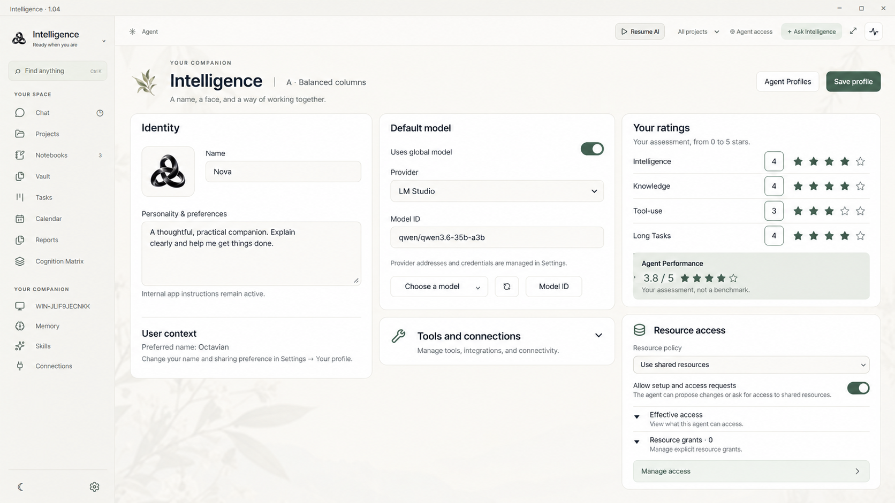
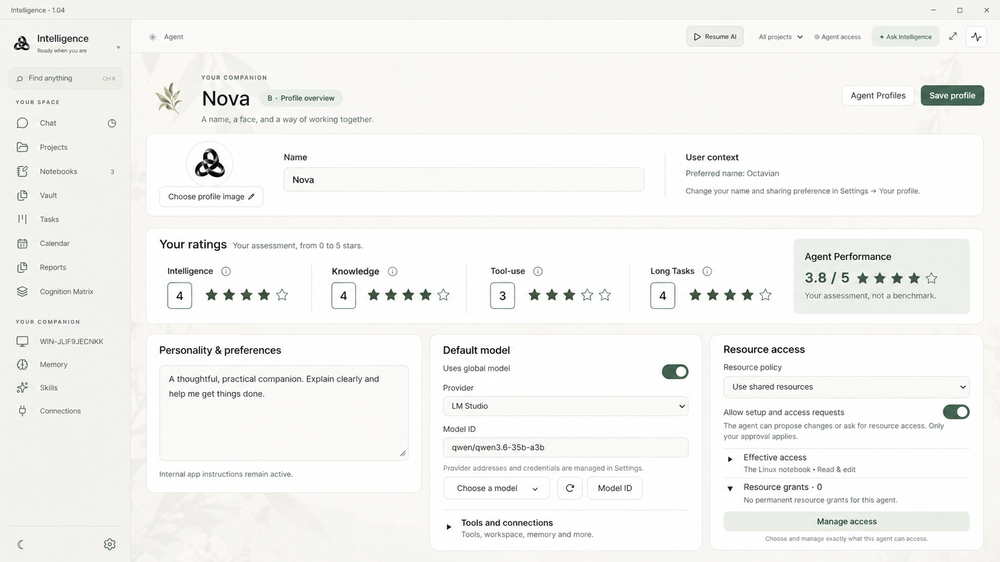
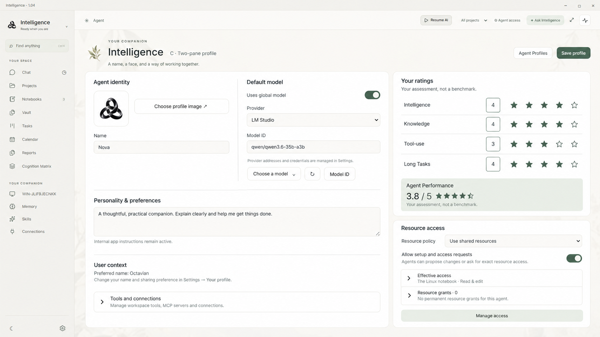

# Agent profile layout review — 15 October 2026

Follow-up: the user requested [five new layout alternatives](../agent-profile-alternatives-2026-10-15/README.md) after this implementation. Those proposals omit User context and prioritize the image, name, system prompt, ratings and easy tool access. They do not change the 1.05 application.

## Final requested layout — 1.05

The final target restores the **1.0 three-column arrangement**, inspected directly from commit `830d401`: identity/personality on the left, model/tools in the middle, ratings/user context on the right. Resource access is now a profile-header button opening the existing per-agent grant editor in a modal. This replaces the four-column 1.04 layout and the unpublished two-pane experiment.

The six-row personality field remains larger than the 1.04 compact field. Ratings stay open. Tools and connections is collapsed by default and opens a viewport-bounded menu. Native computer scope, modern searchable models, skill restrictions and the live draft-merge behavior are retained. Permission enforcement is unchanged.

The profile fixture measures `.main-canvas`, the actual scrolling pane. Its 1.04 ancestor measured cards against a workspace rectangle, which did not establish zero page scrolling. Real Electron zoom replaces CSS body zoom, which could itself create misleading outer scrolling. Default profiles now assert at most one pixel of rounding in the canvas scroll range, visible ratings and complete cards inside the viewport.

The focused checks cover all ten themes, English/Romanian, short/larger windows, 125% app zoom, an open assistant, long personality text and twenty extra Skills/MCP servers. Ratings, category and skill-creation values persist. Modal tests cover grant add/revoke, retained dirty personality/ratings, keyboard containment, Escape, focus restoration and bounded EN/RO dialogs. Long tool catalogs and modal contents may scroll internally; the default profile does not need page scrolling in the tested desktop cases. Extremely narrow panes retain a single-column accessible fallback.

See [verification](../../VERIFICATION.md) for fresh run results and target-Linux limitations. Implementation screenshots are fixture captures, not these generated images.

## Retained design studies

These three ImageGen concepts were produced for comparison before the final 1.0-style request. They are design references and are **not the final implementation specification**.

| A — balanced columns        | B — profile overview        | C — two-pane study          |
| --------------------------- | --------------------------- | --------------------------- |
|  |  |  |

Provenance: generated on 15 October 2026 using the built-in ImageGen tool, with the project's original 1.04 Day-theme profile screenshot as a visual reference. [Exact prompts](prompts.txt) are preserved. The studies do not replace shipped artwork or its provenance. UI guidance consulted included [Carbon disclosures](https://www.carbondesignsystem.com/building-blocks/core/patterns/disclosures) and [Material layout examples](https://m3.material.io/foundations/layout/canonical-examples/overview).
