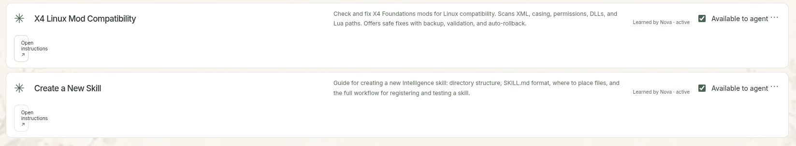
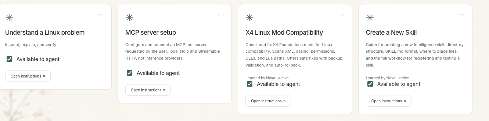

# Collection layout follow-up — 1.03

The user reported these defects after the 1.02 UI pass: Skills card heights varied with descriptions and optional provenance, and learned-skill list rows squeezed Open instructions into the icon column. The earlier review did not catch this combination. The supplied images are visual evidence; their skill text is not development instructions.

Both PNGs are copied unchanged from the supplied attachments. No original artwork or user data was edited.

## Repair

- Shared resource grids stretch cards and use equal-height tracks across rows. Skills, Projects and Connections keep matching card dimensions within their collection, with long text wrapping intact.
- Skills use a reserved provenance line and bottom-aligned availability/instruction controls. List rows use explicit named areas, so optional provenance cannot move the action to an unintended column. Pane container queries handle the assistant, narrow windows and localization.
- The project instructions now require relevant tests only; broaden testing when an issue needs debugging.

## Focused verification

Run a renderer build, then `node scripts/verify-collection-layout.mjs`. It uses isolated fixture data and covers mixed short/long titles and descriptions, generated/non-generated skills and active/review states across multiple rows. It asserts equal dimensions, containment, no control overlap, instruction-button width and aligned card actions. Skills are captured in card/list mode across all ten themes at 1920×1080, then at 1366×768, 2560×1440, 125% scale, Romanian and with an open assistant down to a 1000×700 window. Opening the instruction editor, availability persistence and menus are exercised. Shared Projects/Connections layouts are checked at 1920 and 1366 widths.

The verification record and local artifact directory are in [VERIFICATION.md](../../VERIFICATION.md). This is targeted Windows renderer coverage; target-Linux acceptance remains open. It does not claim another full-app review.
