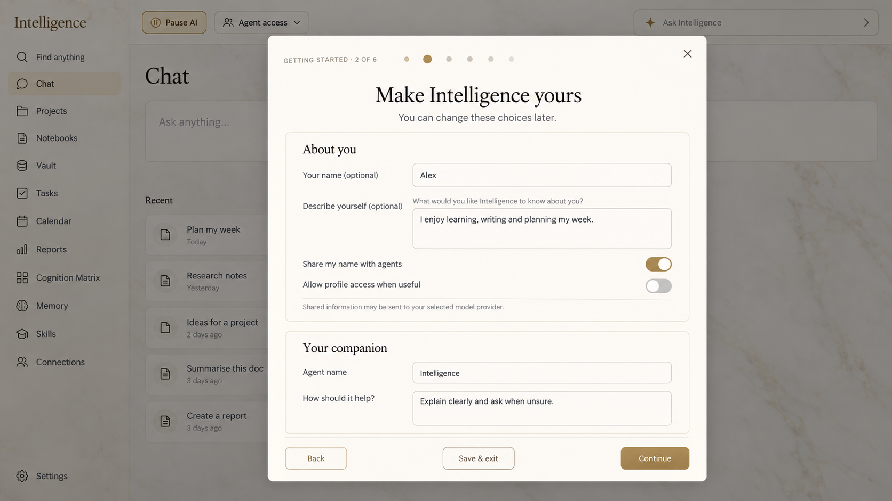
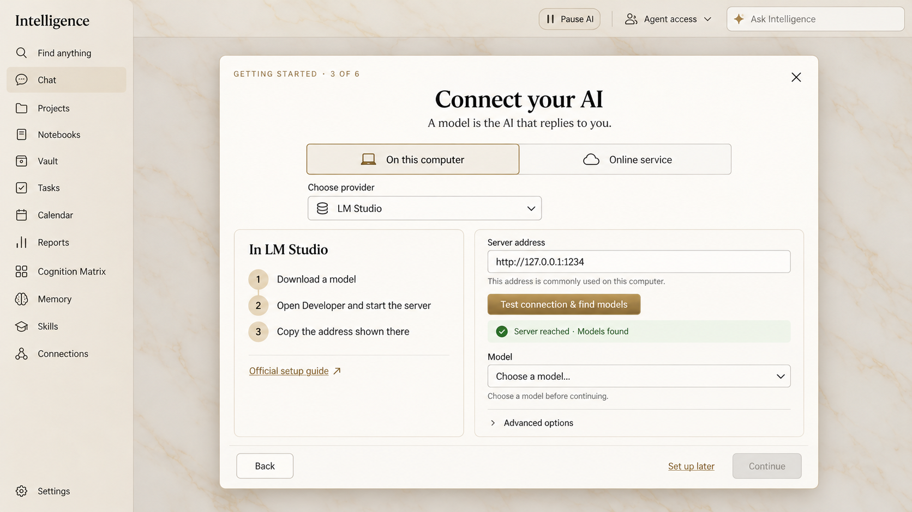
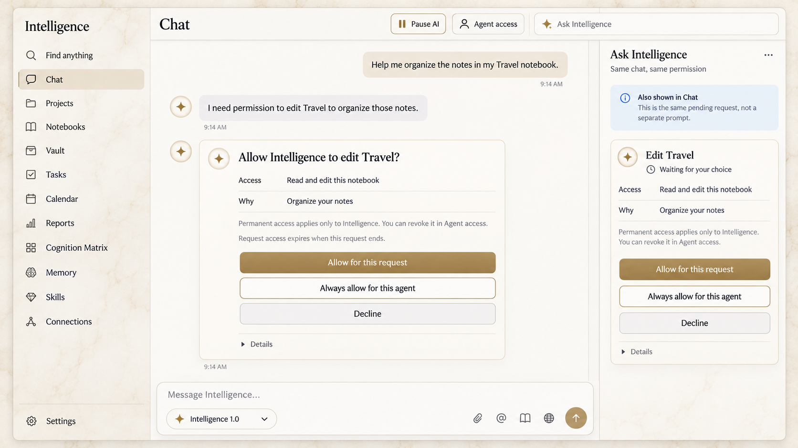
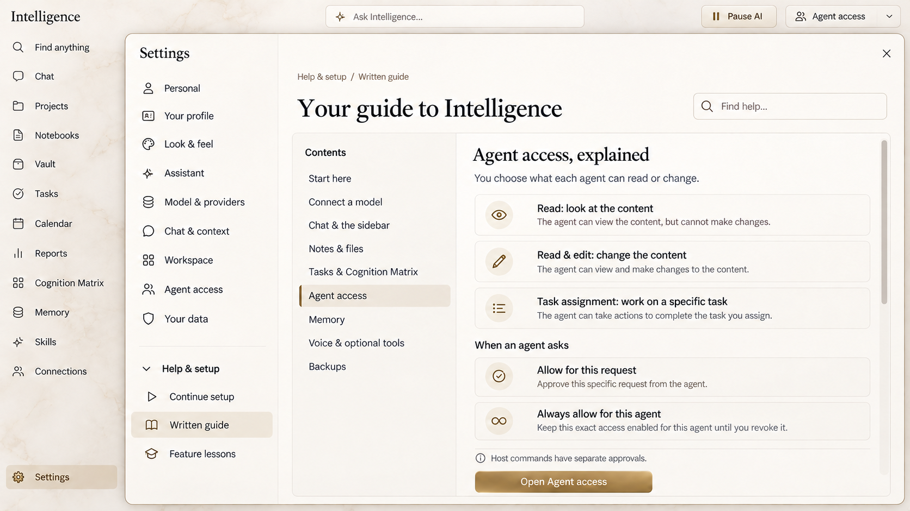

# Intelligence 1.0 — UI review concepts

These images were generated with the built-in ImageGen tool on 2026-10-14. They illustrate the proposal in [the implementation plan](../../ONBOARDING_1_0_PLAN.md). They are design concepts, not screenshots of new functionality. The plan defines exact behavior, permission boundaries and acceptance criteria.

The existing Marble & gold theme informed the visual treatment; existing artwork and branding were preserved. Project-created mockups are provided under GPL-3.0-only. Exact prompts and the targeted wording correction are recorded in [provenance.json](provenance.json).

## You and your companion

## Connect a local model inside setup

## A scoped access request in Chat and the assistant sidebar

The two cards illustrate responsive presentations of one pending request; implementation resolves both together. The generated composer/model label is illustrative. Retain the existing shared model/image/Thinking/TTS/microphone/approval controls in the application.

## Written guide under Help & setup

The renders use abbreviated English copy. They do not verify responsive behavior, actual font metrics, accessibility, keyboard navigation, all themes or Romanian layout. Their raster dimensions are chosen by ImageGen; implementation acceptance still targets 1920×1080 and the supported larger/shorter windows.
