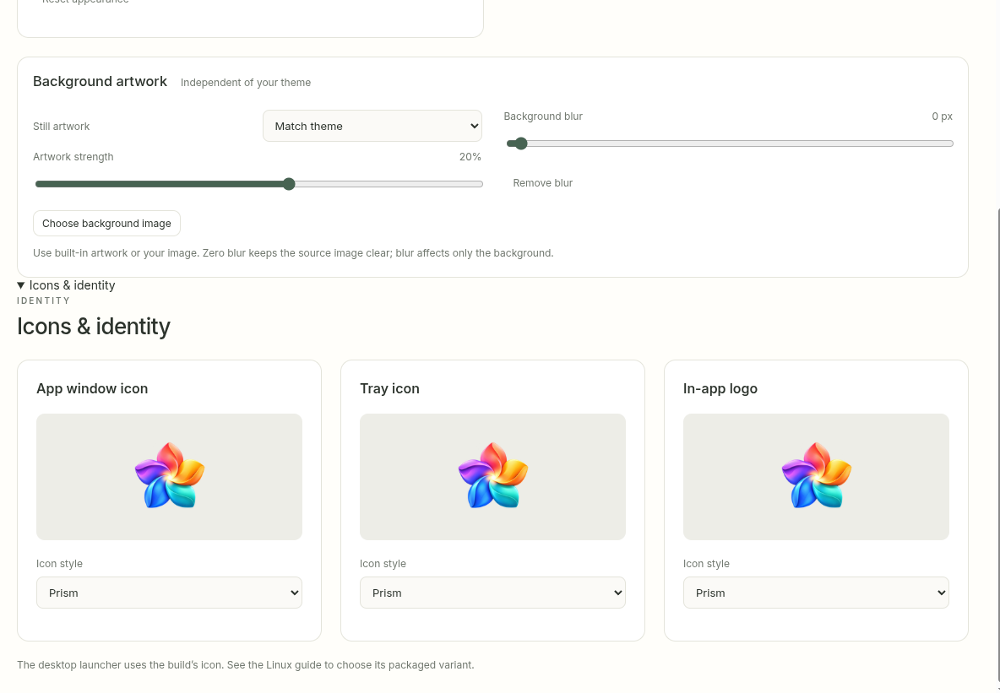
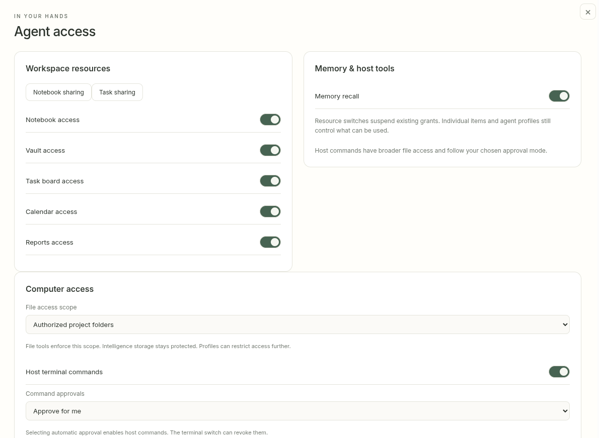
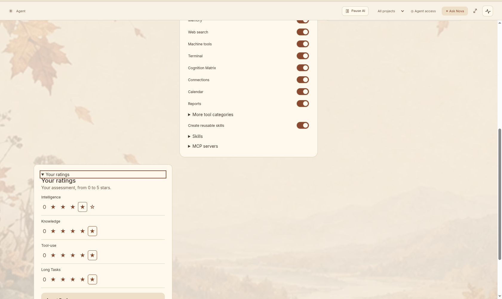
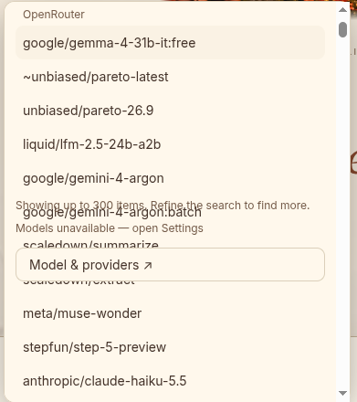
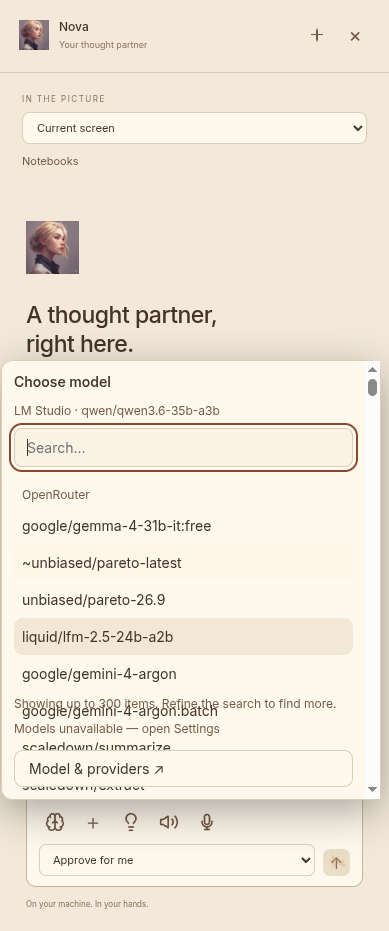

# UI repair checklist — 15 October 2026

Status: implemented and verified locally in 1.02 after the user authorized proceeding with this TODO. The source images and original feedback text are retained beside this document as defect references. See the [review evidence](REVIEW.md) and [verification results](../../VERIFICATION.md) for the repairs, capture coverage and remaining target-Linux limits. No remote action or publication was requested.

The initial planning-only follow-up retained public 1.01/package 1.0.1. The application repairs advance to public 1.02/package 1.0.2 on `dev`, following the project handoff.

## 1. Icons & identity spacing

- [x] Give the disclosure a clear, consistent gap from Background artwork when collapsed and expanded.
- [x] Remove the repeated title/eyebrow hierarchy so expansion has one clear heading.
- [x] Preserve the three independent icon settings, persisted values and existing appearance controls.
- [x] Inspect both disclosure states at normal and increased text scale.

Start with `src/SettingsDialog.tsx`, `src/AppearanceSettings.tsx` and `src/settings.css`. The disclosure previously followed AppearanceSettings without a spacing wrapper; it now has a shared disclosure surface and explicit spacing.

## 2. Workspace sharing button spacing

- [x] Put Notebook sharing and Task sharing in a shared action row with an explicit gap.
- [x] Allow wrapping with the same gap when space or translated labels require it.
- [x] Preserve both navigation actions and visible keyboard focus.

Start with the Workspace resources card in `src/SettingsDialog.tsx` and `src/settings.css`; the formerly adjacent buttons now share a wrapping action row.

## 3. Consolidate agent access

- [x] Review the full global Agent access screen and expanded Access for each agent together before choosing the final grouping.
- [x] Make the relationship between app-wide availability, a selected agent's restrictions, resource sharing/grants and computer permissions understandable in one coherent flow.
- [x] Consolidate repeated headings, explanations and controls. The profile previously listed all tool groups and repeated a subset under More tool categories; each choice now appears once.
- [x] Keep advanced resource inspection and detailed grants discoverable without displaying every detail at once. Show the selected agent and explain effective access and revocation clearly.
- [x] Keep host commands, file-tool scope and destructive/unclassified command approval distinct where they have different effects; explain those differences in plain language.
- [x] Preserve existing settings and grant values, global gates, parent/child exceptions, task assignment, current-request/permanent grants, revision checks, native approvals, live profile checks and mandatory harness guidance.
- [x] Verify a suspended global gate does not silently erase saved grants, and selecting an agent or resource does not grant access by itself.

Start with `src/SettingsDialog.tsx`, `src/AgentAccessPanel.tsx`, `src/ComputerAccessPanel.tsx` and `src/AgentScreen.tsx`. Read `docs/TOOL_ROUTING.md` before touching tools/access; keep authority in native services. The final grouping preserves the existing permission semantics.

## 4. Agent profile page layout

- [x] Arrange identity, model/tools, resource access and ratings into a balanced page with an intentional reading order.
- [x] Prevent the tallest card from pushing unrelated content into a new grid row and leaving large empty areas.
- [x] Preserve profile edits, model choice, access controls, ratings, calculated performance and user context.
- [x] Avoid the repeated Your ratings heading; verify disclosure and focus behavior.
- [x] Check both collapsed and expanded content at desktop and shorter/narrower sizes.

Start with `src/AgentScreen.tsx` and `.agent-profile-layout` in `src/workspace-design.css`. The old automatic grid placed ratings after its tallest row. Independent columns now place ratings below identity; the rendered desktop, assistant, short and scaled layouts were checked.

## 5. Shared model-picker overflow

- [x] Give the choices a bounded, scrollable region that cannot paint beneath the status text or Model & providers action.
- [x] Keep the title, current selection, search, status and footer legible with long provider catalogs and model names.
- [x] Verify placement above and below the trigger, viewport edges and a narrow assistant panel.
- [x] Check searching, no results, the 300-result notice, unavailable-model status, provider grouping and current selection in main chat and the assistant.
- [x] Preserve keyboard navigation, Escape, outside click, focus restoration and provider-qualified choices; keep focused options visible while navigating.

Start with `src/SearchPicker.tsx` and `src/pickers.css`. The original height-limited flex column let `.picker-options` shrink without containing overflow, painting choices over later siblings. The repaired choices region scrolls independently; long catalogs were verified in both chats.

## 6. Full UI and theme consistency pass

The user additionally requested a full UI pass and reported that the large image in Chat seemed bigger in Autumn than in other themes. The baseline reproduced and measured this discrepancy; the repaired frame now matches the other nine themes. Before/after captures and measurements are retained in the isolated fixture artifacts described in the review evidence.

- [x] Review every primary screen: Chat, the assistant panel, notebooks/chapters/notes, Vault, Tasks, Cognition Matrix, Projects, Calendar, Reports, Memory, agents, Skills and Connections. Include all Settings sections, setup/help/lessons, Trash, resource/access views and their dialogs, menus and pickers.
- [x] Review each screen across all ten themes: Ink, Day, Night, Summer, Autumn, Winter Wonderland, Festive, Tech, Astral and Marble & gold. Record the screen/theme coverage and defects so this does not stop at the existing six screenshots or a few representative themes.
- [x] Compare spacing, padding, alignment, page widths, card hierarchy, typography, icon/button/input dimensions, borders, radii, shadows and artwork proportions. Keep shared layout and control geometry consistent while preserving each theme's intended palette and original artwork.
- [x] Check text/control contrast and readability over artwork, hover/focus/selected/disabled/error states, expanded/collapsed sections, empty/populated views and loading/active states where applicable.
- [x] Reproduce the large Chat image difference using the same viewport, UI scale, panel widths and Chat state in Autumn and the other nine themes. Identify the exact image before changing it; capture screenshots and compare rendered bounds and perceived artwork size, including source aspect ratio, transparent padding, cropping, object-fit and theme-specific CSS.
- [x] Correct unintended theme-dependent image sizing or prominence without stretching/cropping away original artwork or replacing assets. Confirm the image's proportions, spacing and relationship to the Chat text/composer remain consistent across themes and window sizes.
- [x] Check 1920×1080 first, then shorter/narrower and larger windows, the narrow assistant, increased text scale, English and Romanian. Inspect clipping, overlap, scroll containment, keyboard focus and viewport-safe overlays.
- [x] Save comparable before/after captures for discovered defects, review the actual rendered screens and record the completed coverage and remaining limitations. Automated overflow checks alone do not establish visual quality.

Use existing theme, Settings and all-app desktop fixtures as a starting point and extend only the meaningful coverage needed. This pass includes any styling regressions discovered beyond items 1–5; preserve application behavior, user content, appearance preferences, artwork/provenance and native access boundaries.

## Completion checks for implementation

- [x] Reproduce each defect before changing it, using isolated fixture data and a sufficiently long model catalog.
- [x] Visually compare repaired screens against these six references at 1920×1080 first, then 1366×768, larger windows, a narrow assistant and increased text scale.
- [x] Inspect English and Romanian, all ten themes as specified in item 6, scroll bounds, horizontal overflow, keyboard access and focus.
- [x] Run TypeScript/build and meaningful affected Settings/profile/picker desktop fixtures; review screenshots as well as automated results.
- [x] Run affected native permission regressions if consolidation changes access-related behavior or wiring. Keep deferred context-length and token-overhead work excluded.
- [x] Record what actually passed and any remaining limits in `docs/VERIFICATION.md`. Do not reuse the earlier fixture results as evidence that these defects are fixed.
- [x] Advance the application version only when application changes land, update relevant release/handoff docs, refresh the ignored source ZIP and make the verified local commit. Push, merge and publication require explicit authorization.

## Reference provenance

`1.png` through `6.png` are unchanged copies of the six screenshots supplied by the user for this review. `feedback.txt` preserves the accompanying `todo.txt` text, with the extra trailing blank line removed for the repository whitespace check. These are defect references, not corrected designs or evidence of completed fixes. The original files outside the repository are preserved.
